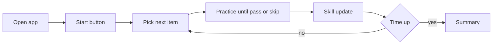

# 빠른 연습

## 1. 배경

배경은 [[design#1. 배경]]과 같다. 연습할 때마다 무엇을 할지 고르는 것이 귀찮다. 앱에 들어와서 시작만 누르면, 지난번에 하던 것부터 이어 하거나 틀린 것부터 복습하길 원한다. 연습 시간도 5분, 10분처럼 정해 두고 싶다.

## 2. 목표

- 사용자는 홈에서 시작 버튼 한 번으로 설정 화면 없이 연습을 시작한다.
- 연습 내용은 학습 기록(취약 리듬, 진도, 마지막 연습일)으로 자동 구성된다.
- 사용자는 설정에서 기본 연습 시간(3, 5, 10, 15분, 제한 없음)을 정해 둘 수 있다.
- 목표 시간이 되면 진행 중인 문제를 마치고 오늘 연습 요약을 보여준다.
- 처음 쓰는 사용자는 가장 쉬운 문제나 기초 진단부터 시작한다.

## 3. 비목표

- AI·LLM 추천. 규칙 기반이다.
- 연습 시간 정각 강제 종료. 문제 중간에 끊지 않는다.

### 실패로 볼 것

- 추천이 늘 너무 쉽거나 어렵거나 같은 문제만 나와서 결국 직접 고르게 된다.
- 일시 정지한 시간까지 연습 시간에 들어간다.

## 4. 사용자 흐름



1. 연습 탭 맨 위 빠른 연습 카드에 연습 시간, 예상 문제 수, 지금 단계, 연속 연습 일수와 시작 버튼이 있다.
2. 시작을 누르면 첫 문제가 바로 나온다. 처음 쓰는 사용자는 1단계부터다.
3. 문제를 통과하거나 건너뛰면 결과 화면에서 "다음 문제" 로 간다. 다음 문제는 이때 정한다.
4. 목표 시간을 넘기면 다음 버튼이 "오늘 연습 요약" 으로 바뀐다. 치던 문제는 끝까지 친다.
5. 요약 화면에서 5분 더 하거나 끝낸다. 결과 화면의 "연습 끝내기" 로 언제든 요약으로 간다.

## 5. 기능 정의

### 설정

설정 탭에 둔다.

| 설정 | 선택지 | 기본값 |
|---|---|---|
| 연습 시간 | 3, 5, 10, 15분, 제한 없음 | 5분 |
| 문제 구성 | 자동, 복습 우선, 진도 우선 | 자동 |
| 기타 스트로크 문제 섞기 | 켜기, 끄기 | 끄기 |

박자 기준음과 방식(보고 치기, 듣고 따라 치기)은 연습 탭의 공통 설정을 그대로 쓴다.

### 문제 종류

| 종류 | 내용 |
|---|---|
| 이어서 | 깨지 않은 첫 단계의 생성 사양으로 새로 만든 패턴 |
| 복습 | 깬 단계 중 약하거나 오래 안 친 음형의 단계에서 새로 만든 패턴 |
| 처음 보는 패턴 | 지금 단계 사양으로 새로 만든 패턴 |
| 도전 | 지금보다 2단계 뒤 단계에서 새로 만든 패턴 |
| 쉽게 다시 | 직전 문제를 건너뛰었으면 같은 음형의 한 부 아래 단계에서 새로 만든 패턴 |
| 기타 스트로크 | 켜 두면 4문제마다 1번, 가장 약한 스트로크 패턴 |

- 모든 문제는 새로 만든 패턴이다. 같은 문제를 외워 잘 치는 것과 실력을 구분하려는 것이다.
- 문제는 모두 두 마디다. 단계의 마디당 새 음형 수를 그대로 쓴다.
- 빠른 연습에서 통과해도 단계를 깬 것으로 치지 않는다. 단계는 [[curriculum#마디 흐름]]으로만 깬다.

### 고르는 규칙

순서대로 본다.

1. 직전 문제를 건너뛰었으면 "쉽게 다시".
2. 남은 시간이 1분 미만이고 복습 후보가 있으면 "복습".
3. 세션 첫 문제는 "이어서". 복습 우선이면 복습 후보부터.
4. 그 밖에는 문제 구성별 비율로 무작위로 고른다. 후보가 없는 종류는 뺀다. 직전 두 문제를 모두 3반복 안에 통과했으면 "이어서" 와 "복습" 을 빼서 새 패턴이나 도전으로 간다.

| 문제 구성 | 복습 | 이어서 | 처음 보는 패턴 | 도전 |
|---|---|---|---|---|
| 자동 | 40% | 30% | 20% | 10% |
| 복습 우선 | 70% | 20% | 10% | 0% |
| 진도 우선 | 15% | 50% | 20% | 15% |

복습 후보 점수는 `약함 + 0.5 × min(쉰 날, 14) / 14` 이고 가장 높은 단계를 고른다. 직전 두 문제와 같은 음형은 뺀다.

### 실력 추정

- 문제 하나를 마칠 때마다 그 음형(복습 단계는 단계)의 점수를 남긴다. 3반복 안에 통과 1, 그보다 늦게 통과 0.6, 건너뛰기 0.
- 음형마다 최근 5개 점수, 시도 수, 마지막 연습 시각을 둔다. 약함은 `1 − 최근 점수 평균` 이다.
- 단계와 고정 패턴 연습, 청음 결과도 같은 기록에 쌓인다. 청음은 `dictation:` 을 앞에 붙인 별도 항목이다.

### 시간과 연속 기록

- 경과 시간은 친 반복 수 × 패턴 길이로만 더한다. 결과 화면에서 머문 시간, 화면을 떠나 중단된 시간은 들어가지 않는다.
- 패턴을 하나라도 마친 날을 기록하고, 오늘 또는 어제까지 이어진 날 수를 연속 기록으로 보여준다.

### 탈락한 후보

| 후보 | 탈락 사유 |
|---|---|
| 시작 전 문제를 사용자가 고름 | 고민 없이 시작하는 것이 목적 |
| 세션 시작 시 문제 전부 확정 | 세션 중 수행 결과를 반영 못 함 |
| 같은 문제 반복 출제 | 패턴 암기와 실력 향상을 구분 못 함 |
| ML 추천 | 데이터가 없고 규칙 기반으로 충분 |
| 일시 정지 버튼 | 반복 시간만 세면 멈춘 시간은 저절로 빠짐. 중간에 멈추면 결과 화면으로 가면 됨 |

## 6. 설계

### 데이터

| 개념 | 담는 것 | 어디에 |
|---|---|---|
| 빠른 연습 설정 | 연습 시간, 문제 구성, 스트로크 섞기 | localStorage `rhythm-lab.settings.v1` |
| 실력 기록 | 음형별 최근 점수 5개, 시도 수, 마지막 연습 시각 | localStorage `rhythm-lab.skills.v1` |
| 연습한 날 | 날짜 목록(최근 400일) | localStorage `rhythm-lab.activity.v1` |
| 빠른 연습 세션 | 목표 시간, 경과 시간, 문제별 결과 | 메모리. 앱을 닫으면 사라짐 |

- 비율과 가중치는 코드 상수다. 써 보고 조정한다.

## 7. 단계

### 7.1 1단계 원탭 시작과 시간제 세션

#### 완료 기준

| # | 상황 | 기대 결과 | 결과 | 확인일 |
|---|---|---|---|---|
| 1 | 첫 실행 후 시작 | 가장 쉬운 문제로 시작 | 통과. quick-curation.test, Chrome 에서 "이어서 · 1. 4분음표와 쉼표 (1부)" | 2026-11-05 |
| 2 | 지난 세션 후 재실행·시작 | 지난 진도·취약 리듬부터 | 통과. quick-curation.test(깨지 않은 첫 단계, 복습 우선이면 가장 약한 음형) | 2026-11-05 |
| 3 | 설정에서 시간 저장 후 시작 | 그 시간짜리 세션 | 통과. Chrome 에서 시간을 3초로 바꿔 한 문제 뒤 요약 버튼 확인 | 2026-11-05 |
| 4 | 목표 시간 도달 | 진행 중 문제 마치고 요약 | 통과. 위와 같은 확인, 요약에서 5분 더·끝내기 | 2026-11-05 |
| 5 | 결과 화면에서 1분 대기 | 경과 시간에 포함 안 됨 | 통과. 경과 시간은 반복 수 × 패턴 길이로만 더함(코드 확인) | 2026-11-05 |
| 6 | 앱 실행부터 첫 연주까지 | 30초 이내 | 통과. 첫 화면 카드의 시작 한 번, 카운트인 1마디 | 2026-11-05 |

### 7.2 2단계 세션 중 조정

#### 완료 기준

| # | 상황 | 기대 결과 | 결과 | 확인일 |
|---|---|---|---|---|
| 1 | 직전 문제를 건너뜀 | 같은 음형의 쉬운 단계, 자동 템포면 −5 BPM | 통과. quick-curation.test, Chrome 에서 80 → 75 BPM | 2026-11-05 |
| 2 | 연속 빠른 통과 | 새 패턴이나 도전 | 통과. quick-curation.test 20개 시드 | 2026-11-05 |

## 8. 코드 배치

```
src/domain/practice/skill.ts            # 실력 점수
src/domain/practice/streak.ts           # 연속 기록
src/domain/curriculum/quick-curation.ts # 다음 문제 고르기
src/presentation/learning-store.ts      # 저장
src/presentation/pages/PracticeApp.tsx  # 세션 흐름
```

## 9. 열린 문제

- 비율과 복습 점수 가중치는 가설이다. 기록이 쌓이면 조정한다.
- 기초 진단은 두지 않고 1단계부터 시작한다. 이미 잘하는 사용자는 단계 목록에서 건너뛰면 된다.
- 요약 화면에 측정 근거가 있는 한 줄 피드백을 넣을지([[TODOS]])
