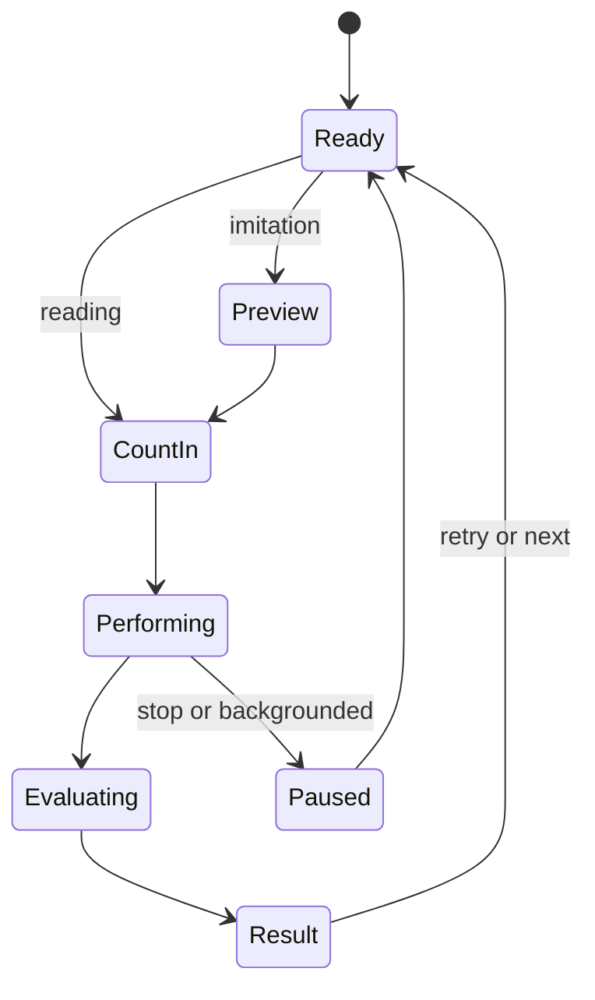

# 읽기·모방 연습

## 1. 배경

배경은 [[design#1. 배경]]과 같다. 악보를 보고 치는 능력과, 소리를 듣고 기억해서 치는 능력은 다르다. 소리를 따라 치는 것과 스스로 박자를 유지하는 것도 다르다. 그래서 같은 리듬을 두 방식으로 연습한다.

## 2. 목표

- 사용자는 악보를 보고 카운트인 후 탭해서 리듬을 연주할 수 있다(읽기).
- 사용자는 리듬을 먼저 듣고, 악보 없이 기억한 리듬을 탭할 수 있다(모방).
- 사용자는 결과를 보고 같은 문제를 다시 하거나 다음 문제로 갈 수 있다.

## 3. 비목표

- 정답 리듬을 들으며 따라 치는 모드를 기본으로 두지 않는다. 읽기에서는 박자 기준음만 들린다.
- 다른 박자표, 점음표, 셋잇단음표. MVP 는 4/4 와 4분·8분·16분음표, 쉼표.

### 실패로 볼 것

- 모방 모드에서 연주 전에 정답 악보가 보인다.
- 미리 듣기와 연주 단계가 구분되지 않아 언제 쳐야 할지 모른다.

## 4. 사용자 흐름

### 공통 상태



### 읽기

1. 문제가 정해진다(빠른 연습, 커리큘럼, 자유 연습 중 하나에서).
2. 악보, 박자표, BPM 을 보여준다.
3. 시작하면 1마디 카운트인.
4. 악보를 보며 탭한다. 커서가 현재 위치를 보여준다.
5. 결과를 보고 재시도하거나 다음 문제로.

### 모방

1. 정답 리듬을 2회 재생한다. 악보는 숨긴다.
2. 재생이 끝나면 카운트인.
3. 기억한 리듬을 탭한다. 기준음은 들린다.
4. 결과에서 정답 악보와 내 입력을 비교한다.

## 5. 기능 정의

### 읽기

- 정식 악보, 현재 위치 커서. 여러 마디면 현재 마디가 보이도록 이동.
- 연습 중 정답 리듬 소리는 기본으로 재생하지 않는다.
- 같은 패턴을 반복하면 새 세션으로 기록.

### 기본 방식

처음 쓰는 사용자의 기본 방식은 모방(듣고 따라 치기)이다. 이미 방식을 저장한 사용자는 저장한 방식을 그대로 쓴다.

### 모방 설정 기본값

| 설정 | 기본값 |
|---|---|
| 미리 듣기 횟수 | 1회. 끝나면 카운트인 없이 바로 연주 |
| 미리 듣기 중 악보 | 보임 |
| 연습 중 악보 | 보임. "악보 숨기고 기억해서 치기" 옵션으로 숨김 |
| 연습 중 기준음 | 켜짐 |
| 결과에서 정답 공개 | 켜짐 |

### 중단

사용자가 멈추거나 앱이 백그라운드로 가면 세션을 미완료로 기록하고 Ready 로 돌아간다.

### 탈락한 후보

| 후보 | 탈락 사유 |
|---|---|
| 연습 중 정답 리듬을 같이 재생 | 소리를 따라 치는 연습이 되어 악보 읽기 훈련이 안 됨 |
| 첫 탭을 기준으로 박자 시작 | 사용자가 박자를 안 쳐도 박자는 계속 가야 함. 카운트인으로 대체 |

## 6. 설계

- 상태 머신은 `src/application/practice-session.ts`. 엔진([[rhythm-engine]])과 판정([[timing-judgement]])을 조합한다.
- 화면 구성과 피드백은 [[practice-screen]].

## 7. 단계

### 7.1 1단계 읽기

#### 완료 기준

| # | 상황 | 기대 결과 | 결과 | 확인일 |
|---|---|---|---|---|
| 1 | 4/4 4분·8분·16분음표·쉼표 패턴 | 악보가 정확히 표시됨 | 통과. VexFlow 로 단계·자유 연습 패턴 652개 렌더링, 화면에서 확인 | 2026-11-05 |
| 2 | 카운트인 1마디 | 4박 재생 후 연주 시작 | 통과. practice-timeline.test, Chrome 에서 카운트인 숫자 확인 | 2026-11-04 |
| 3 | 연주 후 | 결과 화면에 판정과 지표 | 통과. Chrome 에서 결과 화면 확인 | 2026-11-04 |
| 4 | 같은 문제 재시도 | 새 세션으로 기록 | 통과. 다시 하기마다 새 세션 | 2026-11-04 |
| 5 | 연주 중 백그라운드 전환 | 오디오·판정 중단, 미완료 기록 | 미확인. Chrome 에서 화면 가림 이벤트로 중단과 안내 확인. 중단한 연습은 기록하지 않음. 실기기 백그라운드 전환은 미확인 |  |

### 7.2 2단계 모방

#### 완료 기준

| # | 상황 | 기대 결과 | 결과 | 확인일 |
|---|---|---|---|---|
| 1 | 미리 듣기 2회 | 악보 숨긴 채 2회 재생 | 통과. Chrome 에서 "잘 들어보세요" 단계에 패턴 숨김 확인 | 2026-11-04 |
| 2 | 미리 듣기 → 연주 전환 | 카운트인으로 구분됨 | 통과. practice-timeline.test | 2026-11-04 |
| 3 | 결과 화면 전 | 정답 악보 노출 없음 | 통과. Chrome 확인 | 2026-11-04 |
| 4 | 결과 화면 | 정답 악보와 입력 비교 | 통과. 결과 화면에 패턴과 반복별 타이밍 트랙 | 2026-11-04 |

## 8. 코드 배치

```
src/application/practice-session.ts
src/application/exercise-controller.ts
src/presentation/pages/
```

## 9. 열린 문제

- 모방에서 미리 듣기를 다시 들을 수 있게 할지(연주 전 반복 재생)
